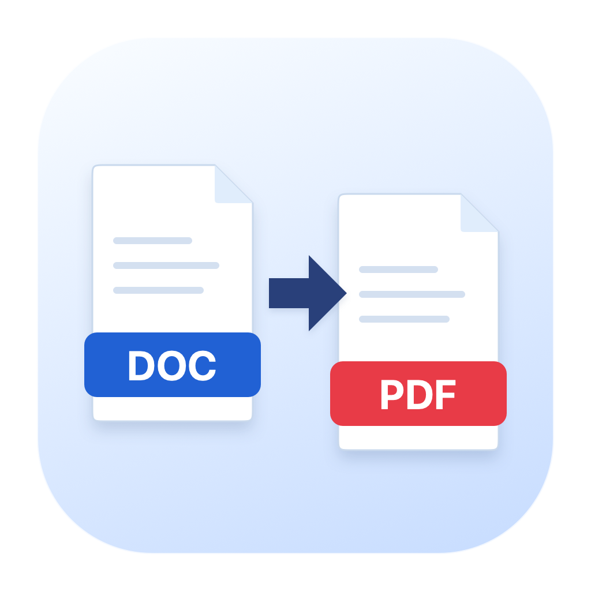

<p align="center"></p>

# PDF Maker

A small native Mac app that turns Word documents into PDFs using your existing
LibreOffice installation. Drop files in the window, or use **Finder → Open With
→ PDF Maker**.

**[Download the latest DMG](https://github.com/kobak/PDFMaker/releases/latest)**

## Install

1. Install [LibreOffice for Mac](https://www.libreoffice.org/download/) if it is not already installed.
2. Download `PDFMaker-1.3.0-Lite-arm64.dmg` from [Releases](https://github.com/kobak/PDFMaker/releases).
3. Open the disk image and drag **PDF Maker** to **Applications**.
4. Open PDF Maker and drop one or more `.doc` or `.docx` files into its window.

Requires an **Apple Silicon Mac (M1 or newer), macOS 13 or newer**. This release
does not support Intel Macs. **The Lite version requires a separate LibreOffice
installation.** Microsoft Word is not required. LibreOffice is not included in
the small download and is not downloaded automatically.
The 1.3.0 Lite DMG is about **0.9 MB**; the app itself is about **1.1 MB**.

PDF Maker looks in `/Applications`, your personal `~/Applications` folder, and
macOS's registered applications. For a custom location, choose **File → Locate
LibreOffice…**; the app remembers your choice. An old Full app's internal engine,
an app in Trash, and an installer volume are not treated as installed LibreOffice.

The larger [self-contained 1.2.0 release](https://github.com/kobak/PDFMaker/releases/tag/v1.2.0)
remains available for Macs without a separate LibreOffice installation.

The app is ad-hoc signed and **not notarized by Apple**. macOS may require manual
approval on first launch. See [Apple's instructions for opening downloaded apps](https://support.apple.com/102445).

## What it does

- Converts DOC and DOCX files locally, with no document uploads.
- Accepts several files through drag-and-drop, Open With, or Choose Files (`⌘O`).
- Saves each PDF beside its original. Existing PDFs are preserved:
  `report.pdf`, `report (2).pdf`, `report (3).pdf`.
- Reveals completed PDFs in Finder using the folder button.
- Supports **English** and **Hungarian**, including menus, progress and errors.

English is the default and fallback language; the interface follows macOS
language preferences. Choose an app-specific language in **System Settings →
General → Language & Region → Applications**.

Complex Word layouts and missing fonts can look different from Microsoft Word's
own PDF export. Password-protected, damaged and empty files produce an error.
The original folder must be writable. Each conversion has a 90-second timeout.

## Build from source

Requires macOS on Apple Silicon, Xcode Command Line Tools, and Python 3.9+.
The default Lite build does not download or copy LibreOffice.

```sh
python3 scripts/build.py
python3 scripts/make_dmg.py
```

The application is created in `dist/1.3.0/lite/`; the DMG, checksum and verification
report go in `dist/1.3.0/release/`.

An optional Full build includes the pinned official engine. It downloads the
engine on the first build, or accepts an existing official bundle:

```sh
python3 scripts/build.py --bundle-engine
# Or: python3 scripts/build.py --engine /path/to/LibreOffice.app
python3 scripts/make_dmg.py --app 'dist/1.3.0/full/PDF Maker.app'
```

`--sign-identity 'Developer ID Application: …'` accepts a local signing identity.
Developer ID signing and Apple notarization are separate from the default local
build. No signing keys or credentials are stored in this repository.

## Verify

```sh
python3 -m venv .venv
.venv/bin/pip install -r requirements-dev.txt
.venv/bin/python tests/verify.py --libreoffice /Applications/LibreOffice.app
```

The checks exercise installed-app discovery, custom locations, stale preferences,
symlinks, missing LibreOffice, both languages, English fallback, DOC and DOCX
conversions, page breaks, Hungarian text, corrupt files, original preservation
and filename collisions. The Lite app is also checked for the absence of the
LibreOffice runtime and a size below 5 MiB.

`--convert`, `--print-engine` and `--print-localization` are verification entry
points in the same executable used by the graphical application. A
`--libreoffice /path/to/LibreOffice.app` argument before the verification mode
uses that external app for the check without changing saved preferences.
Conversions use a private temporary LibreOffice profile; your LibreOffice
settings and open documents are not used or modified.

## Magyarul

Egyszerű, helyben működő Word → PDF alkalmazás Macre. **A kis Lite változathoz
külön telepített LibreOffice szükséges.** Húzd a `.doc` vagy `.docx`
fájlokat az ablakba, vagy a Finderben válaszd a **Megnyitás ezzel → PDF Maker /
PDF-készítő** menüpontot. A PDF az eredeti mellé kerül; meglévő fájlt nem ír felül.
Angol és magyar felületet is tartalmaz. A nyelv a macOS alkalmazásonkénti
nyelvbeállításában választható. A DMG az Apple által nem notarizált kiadás.
Ha a LibreOffice egyéni helyen van, a **Fájl → LibreOffice megkeresése…** menüben
választhatod ki. A teljes 1.2.0 kiadás külön továbbra is letölthető.

## License

The native app and original icon artwork are available under the [MIT license](LICENSE).
The Lite package does not redistribute LibreOffice. Optional Full builds retain
the engine's own licenses and notices; see [Third-party notices](THIRD_PARTY_NOTICES.md)
for the exact version, checksum and corresponding source.
